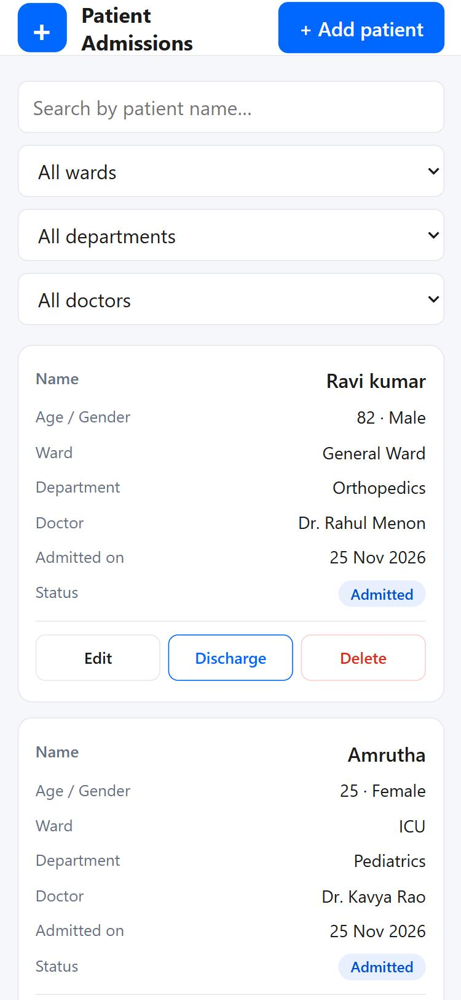

# Patient Admission Management App

This is my submission for the DScribe Software Engineer Intern Round 1 task.
It is a simple web app where hospital staff can add and manage admitted patients.

**Live link:** https://patient-admission-app-6tkp.vercel.app
**Backend API:** https://patient-admission-api-efhx.onrender.com

Note: The backend is on Render free plan, so if it was not used for some time the first load can take around 50 seconds.

## Tech Stack

- **Frontend:** React (made with Vite)
- **Backend:** Python with FastAPI
- **Database:** PostgreSQL on Neon (SQLite when running on my laptop)
- **Hosting:** Vercel for frontend, Render for backend

## Features

- Add a patient
- See list of all patients
- Filter by ward, department and doctor (also by status)
- Search patient by name
- Edit a patient
- Delete a patient (asks for confirmation first)
- Mark a patient as discharged
- Works on mobile and desktop

## Validation

I added validation in both frontend and backend:

- Name is required and can have only letters
- Age is required and must be between 0 and 120
- Gender, ward, department and doctor must be selected from the list
- Admission date is required and cannot be a future date

If wrong data is sent to the backend, it returns a 400 error with a message like `Age must be between 0 and 120`.

## Screenshots

Desktop:


Mobile:



## Folder Structure

```
backend/
  main.py         - all the API routes
  validation.py   - backend validation
  database.py     - database connection and patient table
  options.py      - lists for gender, ward, department, doctor
frontend/
  src/App.jsx                       - main page (list, search, filters)
  src/components/PatientForm.jsx    - add / edit form
  src/components/ConfirmDialog.jsx  - confirm popup for delete and discharge
  src/validation.js                 - frontend validation
  src/api.js                        - functions to call the backend
```

## API Endpoints

| Method | Endpoint | What it does |
|---|---|---|
| GET | `/api/options` | gets dropdown lists |
| GET | `/api/patients` | gets all patients (search and filters as query params) |
| POST | `/api/patients` | adds a patient |
| PUT | `/api/patients/{id}` | edits a patient |
| PATCH | `/api/patients/{id}/discharge` | marks patient as discharged |
| DELETE | `/api/patients/{id}` | deletes a patient |

## How to Run Locally

You need Python and Node.js installed.

**Backend**

```bash
cd backend
python -m venv .venv
.venv\Scripts\activate
pip install -r requirements.txt
uvicorn main:app --reload
```

Backend runs on http://localhost:8000. If `DATABASE_URL` is not set, it saves data in a local SQLite file (`patients.db`).

**Frontend** (in another terminal)

```bash
cd frontend
npm install
npm run dev
```

Open http://localhost:5173 in the browser.

## Deployment

- Database is on Neon. The connection string is added as `DATABASE_URL` in Render environment variables (not in GitHub).
- Backend is deployed on Render with root directory `backend`. `ALLOWED_ORIGINS` is set to the Vercel link.
- Frontend is deployed on Vercel with root directory `frontend` and `VITE_API_URL` set to the Render link.
