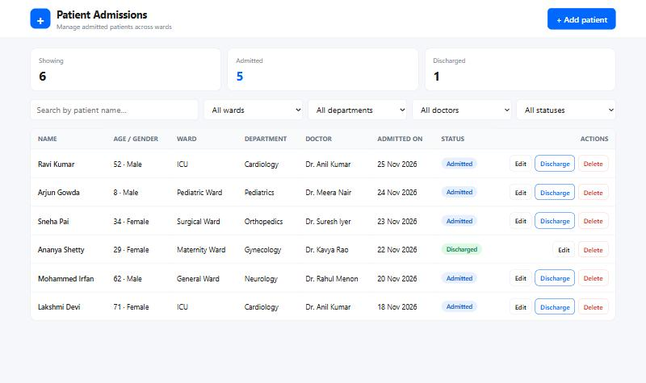
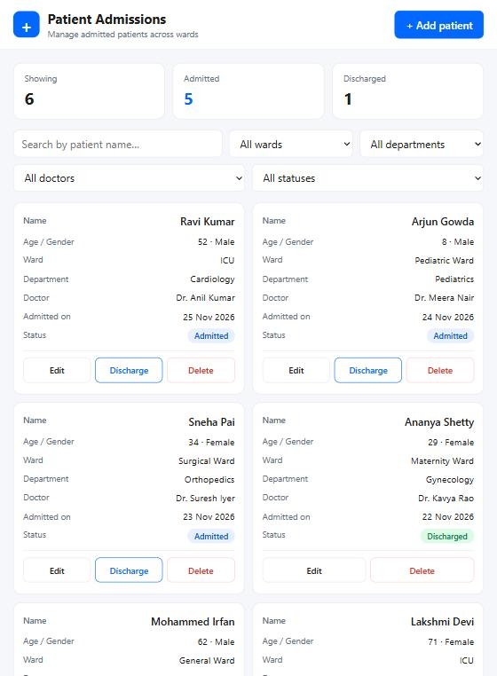

# Patient Admission Management App

A web app for hospital staff to add, view, search, filter, edit, discharge and delete admitted patients.

**Live app:** https://patient-admission-app-6tkp.vercel.app  
**Live API:** https://patient-admission-api-efhx.onrender.com (interactive docs at [`/docs`](https://patient-admission-api-efhx.onrender.com/docs))  
**GitHub:** https://github.com/Shreyaskr0/patient-admission-app

> The backend runs on Render's free plan and sleeps when idle, so the first load can take up to about a minute.

## Tech stack

| Layer | Technology |
|---|---|
| Frontend | React 18 (Vite), plain CSS (responsive: mobile, tablet, desktop) |
| Backend | Python 3.11, FastAPI, SQLAlchemy |
| Database | PostgreSQL (Neon) in production · SQLite file for local development |
| Hosting | Vercel (frontend) · Render (backend) |

## Features

- Add a patient
- View all patients (table on desktop, cards on tablet and mobile)
- Filter by ward, department, doctor (and status)
- Search patients by name
- Edit a patient
- Delete a patient, after a confirmation dialog
- Mark a patient as discharged, after a confirmation dialog
- Validation on **both** frontend and backend:
  - Name: required, letters only (spaces allowed between words)
  - Age: required, whole number between 0 and 120
  - Gender, ward, department, doctor: required, must be from the list
  - Admission date: required, cannot be in the future
  - The backend rejects bad data with HTTP 400 and a clear message for each field

## Screenshots

| Desktop | Tablet | Mobile |
|---|---|---|
|  |  |  |

## Project structure

```
backend/
  main.py          API routes
  validation.py    backend validation rules
  database.py      database connection and Patient table
  options.py       dropdown lists (gender, ward, department, doctor)
frontend/
  src/App.jsx                     list, search, filters, actions
  src/components/PatientForm.jsx  add / edit form
  src/components/ConfirmDialog.jsx
  src/validation.js               frontend validation rules
  src/api.js                      calls to the backend
```

## API

| Method | Endpoint | Description |
|---|---|---|
| GET | `/api/options` | Dropdown lists |
| GET | `/api/patients?search=&ward=&department=&doctor=&status=` | List, search and filter |
| GET | `/api/patients/{id}` | One patient |
| POST | `/api/patients` | Add a patient |
| PUT | `/api/patients/{id}` | Edit a patient |
| PATCH | `/api/patients/{id}/discharge` | Mark as discharged |
| DELETE | `/api/patients/{id}` | Delete a patient |

Example error response (HTTP 400):

```json
{
  "detail": "Name must contain letters only; Age must be between 0 and 120",
  "errors": { "name": "Name must contain letters only", "age": "Age must be between 0 and 120" }
}
```

## Run locally

Requirements: Python 3.10+ and Node.js 18+.

**Backend**

```bash
cd backend
python -m venv .venv
# Windows: .venv\Scripts\activate    macOS/Linux: source .venv/bin/activate
pip install -r requirements.txt
uvicorn main:app --reload
```

The API runs at http://localhost:8000. Without `DATABASE_URL` it stores data in `backend/patients.db` (SQLite), so data stays after a restart.

**Frontend** (in a second terminal)

```bash
cd frontend
npm install
npm run dev
```

Open http://localhost:5173. To point it at another backend, copy `.env.example` to `.env` and set `VITE_API_URL`.

## Deployment

1. **Database (Neon):** create a free project and copy the PostgreSQL connection string.
2. **Backend (Render):** New → Blueprint → select this repo (uses `render.yaml`), or New → Web Service with root directory `backend`, build command `pip install -r requirements.txt` and start command `uvicorn main:app --host 0.0.0.0 --port $PORT`. Set these environment variables in the dashboard:
   - `DATABASE_URL` = the Neon connection string
   - `ALLOWED_ORIGINS` = the Vercel URL, e.g. `https://your-app.vercel.app`
3. **Frontend (Vercel):** import the repo, set root directory to `frontend`, and add the environment variable `VITE_API_URL` = the Render URL.

No passwords or keys are stored in this repository. They are set only as environment variables on the hosts.
